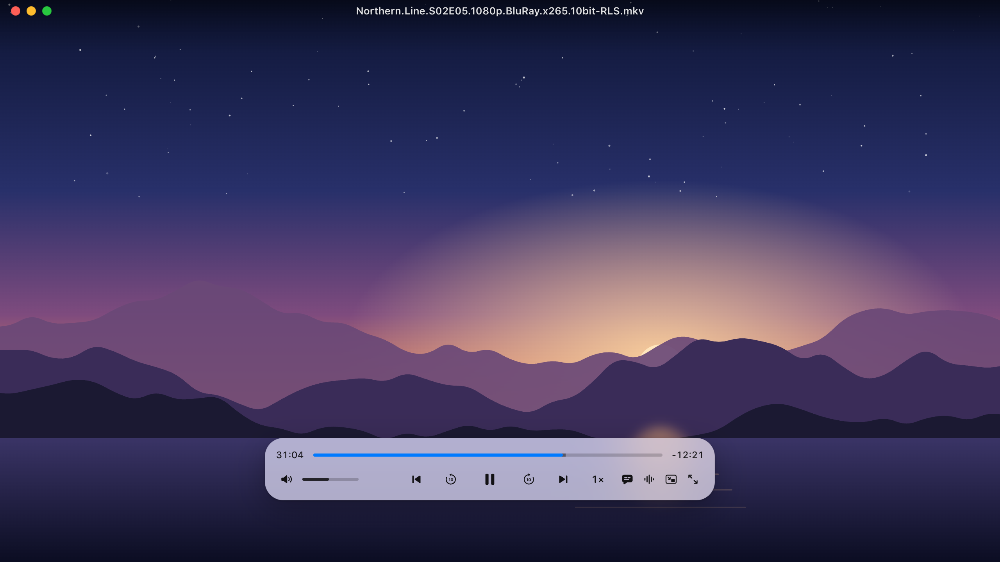

# Reel

Reel is a macOS video player that replaces IINA. It has its own playback engine so that jumping to a different time is fast.



IINA's hardware decode path goes through FFmpeg one frame at a time. Reel demuxes with FFmpeg, calls VideoToolbox directly and shows frames through `AVSampleBufferDisplayLayer`, so an exact seek decodes one group of pictures. In the design measurements this was 3 to 7 times faster. It is built for one Mac (macOS 27, Apple Silicon).

## What it does

- Instant seeking: the seek bar and time label move before any decode, a keyframe preview appears within 80 ms, and the old frame stays on screen (never black) until the new one is ready.
- Plays H.264, HEVC (8 and 10 bit), AV1, VP9 and older codecs in mp4, m4v, mov, mkv, webm, flv, avi, ts, m2ts, mts and ogv, plus wav, mp3, aac and flac. Audio (AAC, AC3, E-AC3, DTS, TrueHD, FLAC, Opus and others) is decoded in software.
- Subtitles: SRT, ASS/SSA, WebVTT, mov_text, PGS, DVD/VobSub and external files next to the video, rendered with libass. Add a subtitle file with Shift-Cmd-O.
- Resume: the position is saved every 5 s and on pause, seek, close and quit, keyed by file content so it survives renames and moves. If Reel has no entry, it reads IINA's saved position for the same file (read-only).
- Thumbnails on hover and while scrubbing, a next and previous episode list from the file's folder with auto-advance, A-B loop and file loop.
- Speed, subtitle and audio delay, subtitle size and position, and track cycling, each confirmed in an on-screen display.
- HDR10 and HLG presentation (Settings: High dynamic range Full, Limited or Off). Dolby Vision profile 8 plays as its HDR10 or HLG base layer; profile 5 (wrong colors) is flagged with a note instead of silently. Video Info shows the dynamic range tag.
- Picture in Picture, Now Playing and media keys, a menu bar, screenshots at native size with subtitles, and output device choice.
- Damaged or odd files show a plain state instead of crashing or hanging.
- Settings: Resume playback where I left off, Show remaining time, Show a keyframe preview while seeking, Hardware decoding, High dynamic range, Output device.

### Keyboard

Bindings are IINA's defaults.

| Keys | Action |
|---|---|
| Space, p | Pause or play |
| Right, Left | Seek +5 or -5 s (exact); Shift-PgUp and Shift-PgDn seek 600 s |
| . and , (or Option-Right and Left) | Frame step forward or back |
| Up, Down | Volume +5 or -5 (Option: 1) |
| m | Mute |
| f, Return, Ctrl-Cmd-F | Fullscreen; Esc leaves it |
| Cmd-O, Cmd-W, Cmd-Q or q | Open, close file, quit (saves resume) |
| Cmd-0, 1, 2, 3 | Window scale 0.5, 1, 2, fit screen |
| Cmd-Right, Cmd-Left | Next or previous episode in the folder |
| Cmd-] and Cmd-[ | Speed x2 and x0.5; Option adds x1.1 steps; Cmd-\ resets |
| Shift-Right, Shift-Left | Next or previous subtitle line |
| Shift-X and Shift-Z | Subtitle delay +0.5 and -0.5 s (with Option 0.1 s); Shift-C resets |
| Shift-9 and Shift-0 | Audio delay -0.5 and +0.5 s; Shift-- resets |
| v | Show or hide subtitles |
| r, t | Move subtitles up or down 1% |
| Shift-G and Shift-F | Subtitle size +10% and -10% |
| Ctrl-Cmd-S, A, V | Cycle subtitle, audio, video track |
| Ctrl-Cmd-P | Picture in Picture |
| Cmd-S | Screenshot to `~/Pictures/Reel` |
| Cmd-L, Shift-Cmd-L | A-B loop (set A, set B, clear); file loop |
| Cmd-I | Video Info |
| Cmd-, | Settings |

## Permissions and what it never does

- Folder access: Reel lists the other videos and subtitle files in the folder of the video you open, so macOS asks once for Documents, Downloads, Desktop or a removable volume. It is not sandboxed.
- Screenshots write to `~/Pictures/Reel`.
- No Screen Recording, Microphone or Camera access.
- Never phones home: FFmpeg is built with `--disable-network`, and there is no analytics, crash reporter, streaming, URL playback or subtitle download. Sparkle is the one network use, in the installed app.
- Never takes focus on its own (it never calls `activate`), never writes to the system recent-documents list, and never changes your default player. You set Reel as the default in Finder yourself.
- Never edits, transcodes or catalogs your files.

## Install and updates

```sh
scripts/deps.sh                         # once: static LGPL FFmpeg and libass into vendor/prefix
scripts/bundle.sh --release --install   # builds Reel.app, signs it, copies it to /Applications
```

Install only when Reel is not running. Reel updates itself with Sparkle from the sdusteric/app-updates feed (contract: `../app-updates/CONTRACT.md`).

# Developer

## Requirements

macOS 27 on Apple Silicon, Swift 6 toolchain, SwiftLint, a network connection for `scripts/deps.sh` (pinned, sha256-verified tarballs) and SwiftPM's Sparkle resolve. Run `scripts/deps.sh` before the first build. Swift must never see Homebrew's FFmpeg headers (struct layouts differ and the spike crashed with SIGBUS). FFmpeg stays LGPL (never `--enable-gpl`, `--enable-nonfree` or `--enable-version3`) and carries one patch, `scripts/patches/ffmpeg-vp9-tile-check.patch`.

## Build, test, check

```sh
scripts/deps.sh                 # FFmpeg 9.0.2 (+ patch) + libass into vendor/prefix (about 60 s cold)
scripts/fixtures.sh             # generated test media into ${REEL_FIXTURES:-build/fixtures} (about 50 s)
swift build --scratch-path "$TMPDIR/reel-<task>"
swift test --scratch-path "$TMPDIR/reel-<task>" --filter <Suite>
swiftlint lint --strict
REEL_SCRATCH="$TMPDIR/reel-check" scripts/check.sh            # every gate
scripts/shots.sh                # 24 scenarios, light and dark, into build/shots
REEL_SCRATCH="$TMPDIR/reel-accept" scripts/accept.sh offline  # M1, then M2 and M3 criteria
REEL_SCRATCH="$TMPDIR/reel-accept" scripts/accept.sh m3       # AC-M3-1 to AC-M3-10 only
scripts/release.sh [--notes <file.md>] [--dry-run <dir>]      # publishes; agents use --dry-run only
```

`check.sh` gates in order: deps, fixtures, build, test, lint, license, `av-sync` (at most 20 ms), `soak-smoke`, no-sparkle, bundle, codesign, plist, sparkle, requirement, dashes. It and `accept.sh` run tests with `SWT_EXPERIMENTAL_MAXIMUM_PARALLELIZATION_WIDTH=8`; set it too when you run the whole suite. Set `REEL_NO_UPDATES=1` for every test, shot or `reelctl` run. Use your own `--scratch-path` outside the repo and `caffeinate -i` for long runs.

`reelctl` is the headless CLI; always set `REEL_HOME` to a temp dir. Tools: `probe`, `decode-bench`, `seek-bench`, `av-sync`, `subs`, `thumbs`, `episodes`, `hdr`, `energy-bench`, `soak`, `devices`, `color`. Example:

```sh
reelctl hdr <file> [--decoder hw|sw] [--display sdr|xdr|external|headroom=X] [--setting full|limited|off] --json
```

## Layout

| Target | Contents |
|---|---|
| `CReelDeps` | C shim over the static libraries |
| `ReelCore` | Pure Swift, Foundation only: shared types, key map (`InputMap`), resume, pure logic |
| `ReelEngine` | FFmpeg and Apple media: demux, VideoToolbox, audio, subtitles |
| `ReelUI` | SwiftUI and AppKit views; talks to the engine through `PlayerEngine` |
| `Reel` | The app executable; the only target that links Sparkle 2.10.0 |
| `reelctl` | The headless CLI |

State lives in `REEL_HOME` (default `~/Library/Application Support/Reel`): `settings.json`, `state.json`, `resume.json`, `logs/reel.log`, `Caches/thumbnails` (500 MB cap). Other variables: `REEL_FIXTURES`, `REEL_IINA_WATCH_LATER`, `REEL_FORCE_DECODER=hw|sw`, `REEL_LOG=debug`, `REEL_SCREENSHOTS`.

Design doc (source of truth): [docs/superpowers/specs/2026-10-24-reel-design.md](docs/superpowers/specs/2026-10-24-reel-design.md). The mockup is `docs/mockup/index.html`.

## Rules for agents

- Never show a window, take focus or trigger a permission dialog; never run `open` or osascript. The Reel binary runs only in `--shot` mode or as `reelctl`, with `REEL_HOME` and `REEL_NO_UPDATES=1` set.
- Never make a sound: no test attaches an audio renderer, and `REEL_ALLOW_AUDIO=1` is never set.
- Never read your media or private folders. All media comes from `scripts/fixtures.sh`. Tests point `REEL_IINA_WATCH_LATER` at a fake dir.
- No network except `deps.sh` and the SwiftPM resolve. No `URLSession`, `NWConnection` or `import Network` in `Sources/`.
- No `try!` in `Sources/`, no `try?` in `ReelCore` store files.
